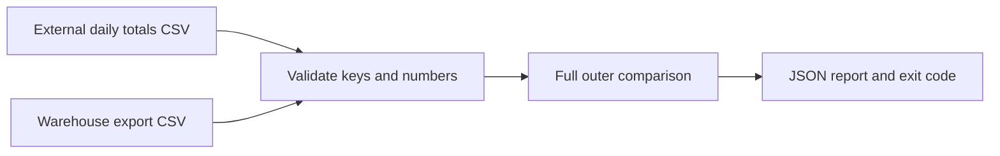

# Marketing data reconciliation

Compare independently supplied daily totals with warehouse exports. Missing rows, extra rows and numerical differences are separate findings; zero is a real value.

Synthetic examples only. This repository performs no network calls and repairs no data.

## Example result
`fixtures/broken.csv` compared with `fixtures/expected.csv` produces these three findings (all for `synthetic-store`):

| Date | Metric | Expected | Actual | Delta | Status / next action |
|---|---|---:|---:|---:|---|
| 2026-01-01 | pageviews | 202 | 0 | -202 | mismatch: inspect the export |
| 2026-01-07 | pageviews | 214 | null | null | missing_actual: reload the missing day/metric |
| 2026-01-08 | visits | null | 8 | null | unexpected_actual: check the requested range |

The command exits 1; the matching fixture exits 0. Invalid input exits 2 without a traceback. Dates must be YYYY-MM-DD; whitespace in keys is rejected, not silently merged.

## Run
Python 3.10+, no dependencies.
```sh
make demo
make test
python3 reconcile.py fixtures/expected.csv fixtures/broken.csv
# Expected exit 1 and three discrepancies; report in output/report.json.
```
Exit 0 means all supplied keys match; 1 means discrepancies; 2 means invalid input. Decimal arithmetic avoids float rounding. Absolute/relative tolerance defaults to zero. Duplicate keys and empty inputs fail validation.

## Architecture


## Evidence boundary
The fixtures are independently supplied inputs to the comparator, but the demo generator creates both: this is not a real external API check. Define timezone, metric, attribution window and sampling before comparing real exports. Matching totals cannot prove row-level correctness. No client data or code is included.

[Design and operating notes](docs/architecture.md). MIT licence.

## Tolerances and adaptation
`--relative 0.01` permits 1%; `--absolute 2` permits two metric units. The larger allowance wins; missing keys never pass. For this synthetic example, dates represent UTC calendar days, visits are session counts and pageviews are page-view counts, with no sampling or attribution window. Agree those definitions with both real sources before comparing. I would add source adapters and alert routing around this comparator; it does not repair data automatically.

[CI checks](https://github.com/zoercalm/marketing-data-reconciliation/actions/workflows/ci.yml)
