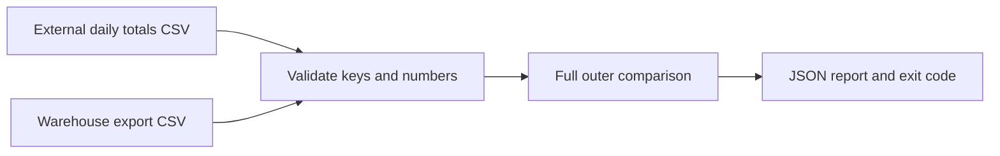

# Marketing data reconciliation

Compare independently supplied daily totals with warehouse exports. Missing rows, extra rows and numerical differences are separate findings; zero is a real value.

Synthetic examples only. This repository performs no network calls and repairs no data.

## Run
Python 3.10+, no dependencies.
```sh
make demo
make test
python3 reconcile.py fixtures/expected.csv fixtures/broken.csv
# Expected exit 1 and three discrepancies; report in output/report.json.
```
Exit 0 means all supplied keys match; 1 means discrepancies; 2 means invalid input. Decimal arithmetic avoids float rounding. Absolute/relative tolerance defaults to zero. Duplicate keys and empty inputs fail validation.

## Architecture


## Evidence boundary
The fixtures are independently supplied inputs to the comparator, but the demo generator creates both: this is not a real external API check. Define timezone, metric, attribution window and sampling before comparing real exports. Matching totals cannot prove row-level correctness. No client data or code is included.

[Design and operating notes](docs/architecture.md). MIT licence.
